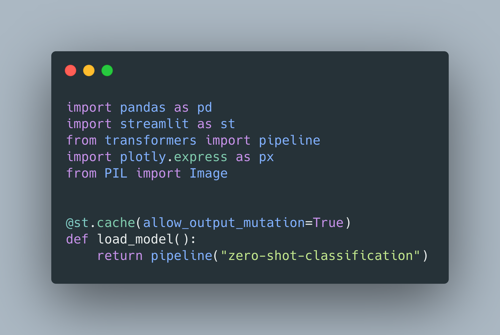

Created an app to to zero shot classification using huggingface 🤗 library.

In this app, I created a simple [streamlit](https://streamlit.io/) app to try out the [zero-shot-classification](https://discuss.huggingface.co/t/new-pipeline-for-zero-shot-text-classification/681) pipeline provided by HuggingFace.

**Please take a look at the code here**

[https://github.com/ygivenx/zero-shot-classifier-app](https://github.com/ygivenx/zero-shot-classifier-app)

**Or try it yourself by running**

Make sure your docker memory is set to over 6GB.  
`docker pull ygivenx/zero-shot-app`  
`docker run -it -p 8501:8501 ygivenx/zero-shot-app`
