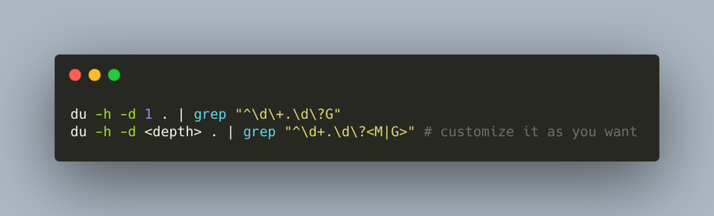

Several times, you realize that you need to see folder with a lot of data in it. I have used this command several times and find it really useful to see all the large folders lying around in the current dir.
