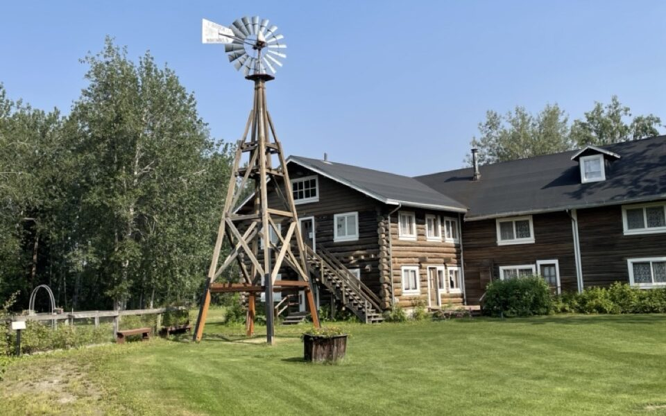

Old ways 🆚 New Ways

Hello 👋🏽

Here are two things that I pondered 💭 over the weekend.

### What do you want in life?

A snippet from the Collaboration Fund newsletter [blog](https://www.collaborativefund.com/blog/lifestyles/) by Morgan Housel (Author of the Psychology of Money) -

… Fifty-four years ago… _Sunday Times_ offered £5,000 to whoever could sail solo nonstop around the world … The two men, Donald Crowhurst and Bernard Moitessier, are astounding examples of how the quality of your life is shaped by whom you want to impress. Their stories are extreme, but what they dealt with was just a magnified version of what ordinary people face all the time, and likely something you’re facing right now…

This article will give you a profound sense of how your life can end up in a very different place given what you value today.

I realized I am somewhere between the two extremes that are discussed, but I never realized that it is up to me to balance the two extremes.

### Something to think about

> If you can do something in the old paradigm you should, but when there is a new paradigm, like the internet, you want to find things that you just can't do in the old paradigm to exploit the full potential of the new paradigm.
> 
> Jeff Bezos

I found this thought/quote very powerful while listening to David Rosenthal and Ben Gilbert on the [Acquired](https://www.acquired.fm/episodes/amazon-com) podcast on Amazon.com. It is a long episode, over 3 hours - but it is interesting and very well narrated.

The Amazon podcast made me think how a new paradigm could have saved so many businesses/companies only if they made the investment to change themselves and get a temporary hit on their profitability. Imagine if Barnes and Nobel went full steam selling books on the internet!

Please share your thoughts/feedback in the comments.
