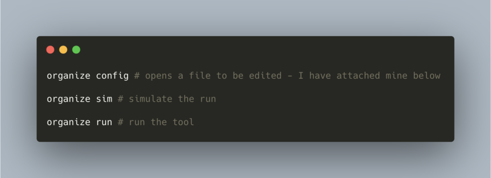

Target Users

If you use **python** and like having an **organized** computer - this article is for you 👋🏽

The data 💿 in your mac 💻 is spread around into downloads, desktop, etc.There is a **python** 🐍 tool `organize-tool` which can help you declutter and organize all your data with a simple YAML configuration.

The **best** part is that - you can also have `python` code in actions.

Thanks 😄 to [tfeldmann](https://github.com/tfeldmann) for this awesome 😎 tool

Installation: `pip3 install -U organize-tool`

💫 Github: [https://github.com/tfeldmann/organize](https://github.com/tfeldmann/organize)

📚 Docs: [ReadTheDocs](https://organize.readthedocs.io/en/latest/)

🚗 Usage 👋🏼



```
rules:
    # move files to folder according to extension
    - folders:
        - ~/Downloads/**/*
        - ~/Desktop/**/*
      filters:
        - extension:
          - pdf
          - docx
          - jpg
          - pptx
          - xlsx
          - mov
          - mp4
          - m4a
          - png
          - heic
          - csv
          - jpeg
          - json
          - key
          - zip
      actions:
        - move: ~/Documents/{extension.upper}/
    # Move screenshots to a dir
    - folders: ~/Desktop
      filters:
        - filename:
            startswith: "Screen Shot"
      actions:
        - move: ~/Desktop/Screenshots/
    # remove empty files
    - folders:
          - ~/Downloads
          - ~/Desktop
      filters:
          - filesize: 0
      actions:
          - trash
    # remove partial downloads
    - folders: ~/Downloads
      filters:
          - extension:
                - download
                - crdownload
                - part
                - dmg
          - lastmodified:
                days: 2
                mode: older
      actions:
          - trash
    # remove duplicate files
    - folders:
        - ~/Desktop
        - ~/Downloads
        - ~/Documents
      subfolders: true
      filters:
        - duplicate
      actions:
        - echo: "{path} is a duplicate of {duplicate}"
        - trash
```

Let me know how used it in the comments below :)

Cheers!
