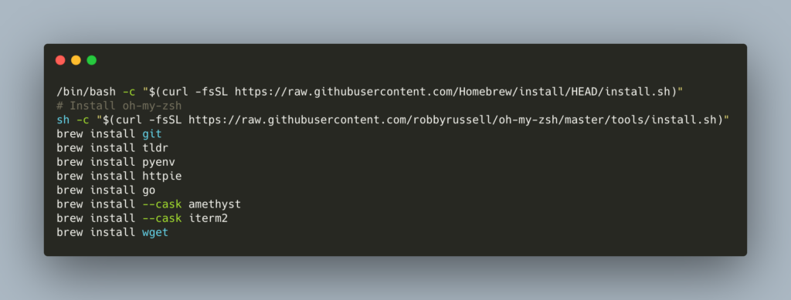
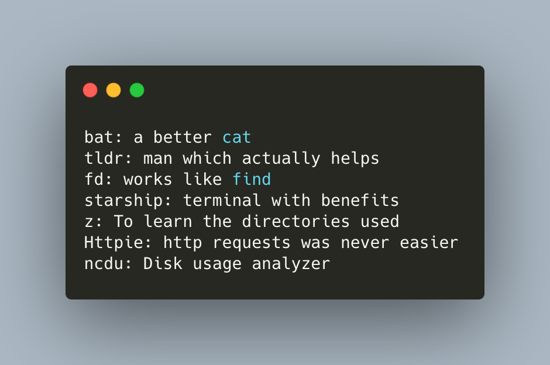
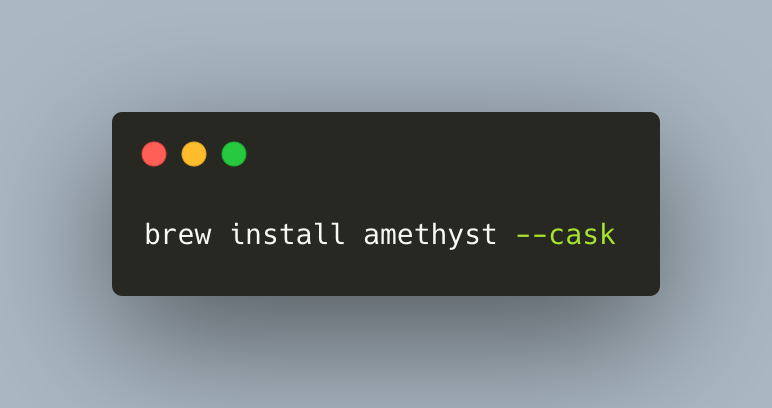

Update Feb 2024 with Mac OS Sonoma on M3 Pro.

I, recently, changed jobs and got a brand new mac. Now, I am a data scientist and I wanted my new mac to be familiar. In this post, I wanted to show what I installed on my new mac to make it somewhat efficient from the get-go. I Hope, this post will help you get started, quickly :)

1\. Install Xcode

`xcode-select --install`

2\. Install Packages

Install basic utility packages to get ready to change the world with AI :)

- homebrew
    - 🔔 Make sure to follow the instructions printed after homebrew install is completed

- oh-my-zsh
    - `sh -c "$(curl -fsSL https://raw.githubusercontent.com/ohmyzsh/ohmyzsh/master/tools/install.sh)"`
    
    - Enable oh-my-zsh plugins
        - git
        
        - aliases
        
        - python

- git
    - Setup git ssh
    
    - Install git lfs - `brew install git-lfs`

- pyenv - Manage mulitple python environments)

- tldr - Get useful help with command line tools

- httpie - A simpler curl

- amethyst - manage multiple windows

- iterm - a better terminal

3\. Python 🐍 Installation

- initialize pyenv - `eval "$(pyenv init -)"`

- restart shell - \`exec $SHELL\`

- pyenv install 3.12

- pyenv global 3.12

4\. Install **Docker** (increase memory or at least make a note of this in your mind if some data science images don't work)

6\. **CLI** Starters

7\. Apps

- **Amethyst**

- **1Password**

- **VS Code**
    - Also add VS code to your command line
