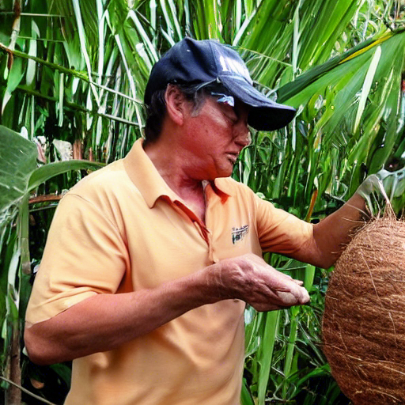

Can we believe 👀 anything we see online anymore?

<figure>

<figcaption>

Trump picking up Coconuts in Thailand - Image generated artificially

</figcaption>

</figure>

Hello 👋🏽

An algorithm generated the picture you see above. It took me 10 minutes to set up and I can generate anything you can think of in some form. Imagine the information you will see going forward - how will you understand whether what you see is real or not?

In a world where the skill gap is increasing day by day, I wonder what will the social standing of people who are either not a part of such advances or do not understand the latest technologies. Will they become a target of sophisticated misinformation campaigns that will take advantage of them politically, socially, economically, financially, personally, and in countless other ways?

However, I think all new technologies are horrible when they are invented. The [stable diffusion](https://arstechnica.com/information-technology/2022/09/with-stable-diffusion-you-may-never-believe-what-you-see-online-again/) technology which I used to generate the picture above may be threatening to artists and creators, but isn’t that how painters felt when the camera was invented or bookmakers felt when the Printing Press was invented?

Check out some examples of what stable diffusion is capable of on 👉🏼 [twitter](https://mobile.twitter.com/stablediff).

## Thoughts 🤔

I recently read [The Lincoln Highway](https://amzn.to/3RLXH1V) by Amor Towles and encountered a very interesting paragraph -

> But maybe, I was thinking as I was driving over the Hudson River, just maybe the will to stay put stems not from a man’s virtues but from his vices. After all, aren’t gluttony, sloth, and greed all about staying put? Don’t they amount to sitting deep in a chair where you can eat more, idle more, and want more? In a way, pride and envy are about staying put too. For just as pride is founded on what you’ve built up around you, envy is founded on what your neighbor has built across the street. A man’s home may be his castle, but the moat, it seems to me, is just as good at keeping people in as it is at keeping people out.

Do you feel the same way about staying put? I couldn’t agree more with this thought and would love to get another perspective.

### Success 🏆 and Failure 🔻

I read about an observation made somewhere that talked about how you can be successful in very few ways but you can fail in a lot of ways - just like you can arrange a jigsaw puzzle incorrectly in so many ways but there is just one correct arrangement out of millions. Something along the lines of Tolstoy - All happy families are alike but all unhappy families are unhappy in their own way.

Is this the reason why so many people do similar things to be successful - they study, go to college, get a nice job, save money and retire? Are the very successful people who did not take a defined path outliers?

### Her Majesty 🏴󠁧󠁢󠁥󠁮󠁧󠁿

Queen Elizabeth, the Monarch of Britain, Australia, Canada, New Zealand, Papua New Guinea, Jamaica, Solomon Islands, Bahamas, Belize, Saint Lucia, Grenada, Saint Vincent and the Grenadines, Antigua and Barbuda, Saint Kitts and Nevis and Tuvalu died on September 8, 2022. A historical day indeed.

As a person who moves on in life, I am really excited to see the coronation 👑 of King Charles III.
