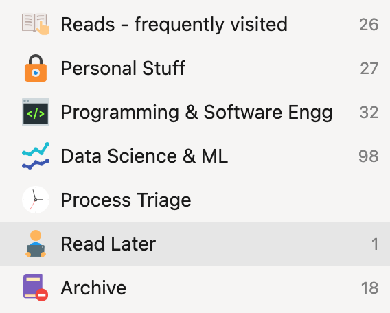

I am a Data Scientist 📊 and a productivity fanatic! I love economics, technology and history. Here is a list of things I use to make my life better.

<figure>


<figcaption>

Photo: Maman - A cute little Cafe in Little Paris, NY

</figcaption>

</figure>

### [📚 Reading](#Reading)

### [📲 Apps](#Apps)

### [🎧 Podcasts](#podcasts)

### [📚 Books](#books)

### [⌚️ Products](#products)

### [🎥 Movies and Documentaries](#movies)

```
I always buy/watch/use things which are recommended by people I trust. This page will help you cut through the recommendation-saturation. 
```

# 📚 Reading

## August 2023

### Articles

- [Ars Technica: Want to have your gene tested? It might be genetic](https://arstechnica.com/science/2023/08/genetics-makes-some-people-more-likely-to-participate-in-genetic-studies/)
- [Wired: I saw the Face of God in a Semiconductor Factory](https://www.wired.com/story/i-saw-the-face-of-god-in-a-tsmc-factory/)
- [Open Challenges in LLM Research](https://huyenchip.com/2023/08/16/llm-research-open-challenges.html?utm_source=tldrai)

# 📲 Apps

## Snipd (Podcast Listening)

It is a Machine Learning based app which lets you highlight podcasts and also see what others highlighted. It is completely **free** right now. You can bookmark podcast with your Airpods or CarPlay easily too.

## YNAB (Budgeting)

If you want to spend your money guilt-free 🤑, I would highly recommend this budgeting app. This app has helped me cut down my unnecessary expenses and allowed me to do more meaningful things with my money. Now, I am able to take extravagant trips which I was never able to take before as I can mercilessly reduce my stupid expenses.

👉🏼 Click here to get an additional free month when you click on this [link](https://ynab.com/referral/?ref=idN9o3SPwFToq0hm)

## Raindrop.io (Bookmark)

This [app](https://raindrop.io/) lets you store the bookmarks across devices. If you are stuck with different browsers on phone and computers - it can help you abstract away the bookmarking. Overall, I use this app as an organizer for my online activities.

<figure>



<figcaption>

Snippet of Bookmark Folders on Raindrop.io

</figcaption>

</figure>

* * *

# 🎧 Podcasts

## Acquired

This podcast analyses the history of tech companies.

Favorite Episode: https://www.acquired.fm/episodes/lvmh

## The Knowledge Project

Shane has insightful interviews with experts.

Favourite Episode: https://fs.blog/knowledge-project-podcast/naval-ravikant-171/

* * *

# 📚 Books

The Wager by David Grann

* * *

# ⌚️ Products

- **Dock for Mac**

I have been using this [Anker](https://amzn.to/3AMCwqI "Anker") Dock for my 2021 Macbook Pro and it is wonderful.

* * *

# 🎥 Movies and Documentaries

Oppenheimer

## 🗞 Get my newsletter!
